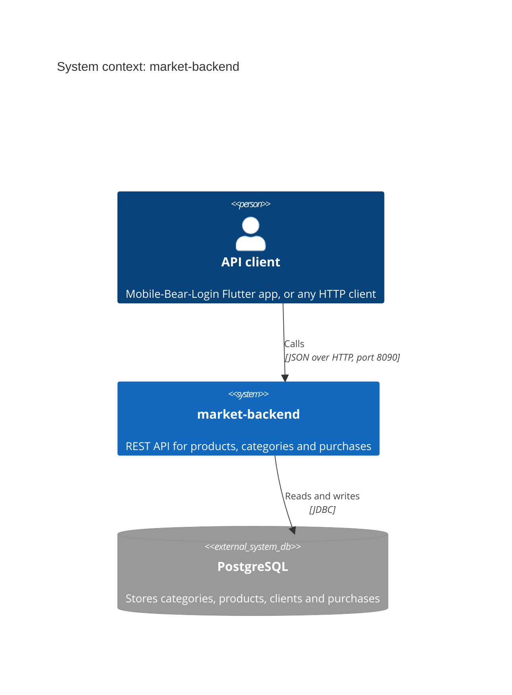
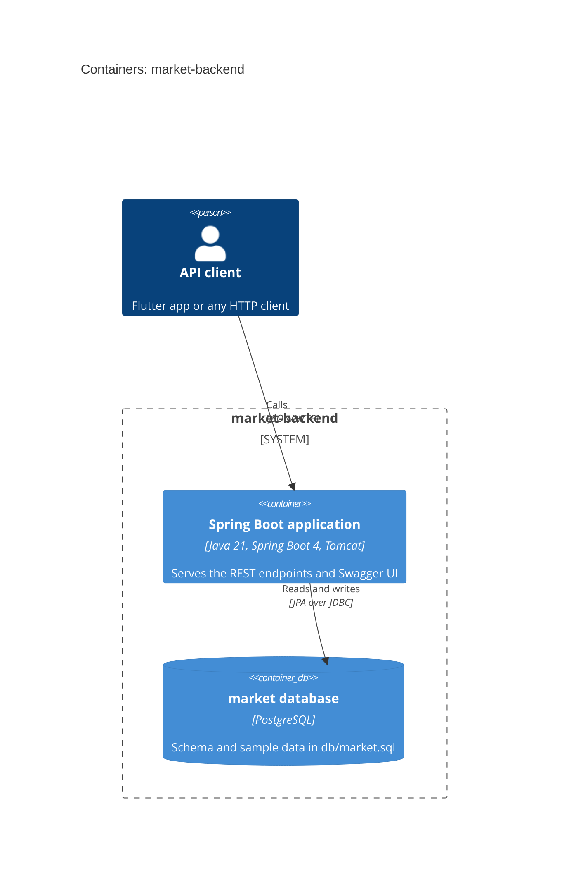
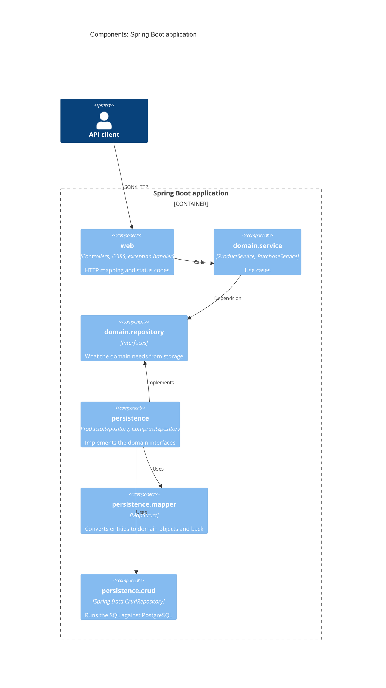

# Architecture

This document explains how market-backend is organized: what each layer owns, how a request travels through the code and why some choices are not obvious. Read it before changing anything below `src/main/java`.

## System context

The API is the only component that talks to the database. Clients never see table or column names.

## Containers

There is one deployable unit, a single JAR built with `./gradlew build`. Swagger UI and the OpenAPI document are served by the same process through springdoc-openapi.

## Components

## Layers

All code lives under `src/main/java/mx/edu/tecdesotware/Market_Backend/`.

| Package | Owns | Depends on |
|---|---|---|
| `web` | Controllers, Swagger annotations, CORS, `GlobalExceptionHandler` | `domain` |
| `domain` | Models (`Product`, `Purchase`…), services, repository interfaces | nothing |
| `persistence` | JPA entities, Spring Data repositories, MapStruct mappers, domain repository implementations | `domain` |

The rule: `domain` imports nothing from `web` or `persistence`. Services depend on the `ProductRepository` and `PurchaseRepository` interfaces; Spring injects the implementations from `persistence`. Swapping the storage means writing new implementations of those two interfaces, without touching controllers or services.

## Request flow

`POST /purchases/save` exercises every layer:

1. `PurchaseController.save` receives the JSON and Jackson binds it to a domain `Purchase` with its `PurchaseItem` list.
2. `PurchaseService.save` passes it to the `PurchaseRepository` interface.
3. `ComprasRepository.save`, the implementation, calls `PurchaseMapper.toCompra` to build the JPA entity `Compra` with its `ComprasProductos`.
4. It sets the parent `Compra` on every item. The items use `@MapsId` with the composite key `CompraProductoPK`, so they need the parent reference to derive `id_compra`.
5. `CompraCrudRepository.save` inserts the purchase and its items in one transaction.
6. The saved entity is mapped back to a `Purchase` and returned with `201 Created`.

If `clientId` or a `productId` does not exist, PostgreSQL rejects the foreign key. `GlobalExceptionHandler` turns the resulting `DataIntegrityViolationException` into a `400` problem response instead of a `500`.

## Decisions

### Spanish tables, English API

The database schema and JPA entities use Spanish names (`productos`, `cantidad_stock`, `Compra`). The domain models and JSON use English (`products`, `stock`, `Purchase`). The mappers are the only place where both meet.

This keeps the public contract stable and readable for any client while the schema stays as it was designed. A column rename touches one entity and one mapper, never the JSON.

### MapStruct instead of hand-written mapping

MapStruct generates the mapping code at compile time from annotations such as `@Mapping(source = "cantidadStock", target = "stock")`. A misspelled field fails the build instead of returning `null` at runtime, and there is no reflection cost per request.

Two mappings are one-way on purpose:

- `ProductMapper.toProducto` ignores `categoria`. The foreign key is written through `idCategoria`; the association is read-only.
- `PurchaseMapper.toCompra` ignores `cliente` to avoid a `Compra` and `Cliente` cycle.

### Empty lists become 404

`getByCategory` and `getByClient` return `Optional.empty()` when no rows match, and the controllers answer `404`. A client can tell "no such category or client" apart from a server error, at the cost of not distinguishing it from "exists but has no rows".

## Where to change things

| To | Edit |
|---|---|
| Add an endpoint | a controller in `web/controller`, then the service and repository interface in `domain` |
| Add a column | `db/market.sql`, the entity in `persistence/entity`, the mapper, the domain model |
| Change an error response | `web/exception/GlobalExceptionHandler` |
| Allow a specific origin | `web/config/CorsConfig` |
