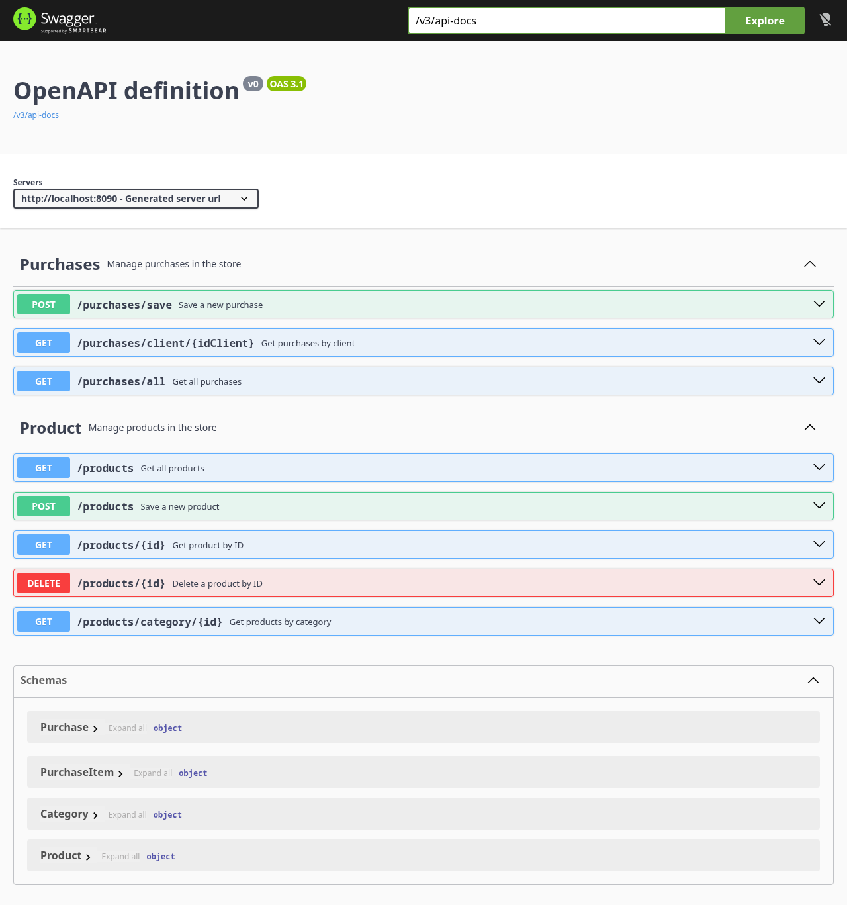

# market-backend

REST API for a grocery store: products, categories and purchases, stored in PostgreSQL. Built with Spring Boot 4 and Java 21.

[](https://github.com/Joako601/market-backend/actions/workflows/ci.yml)
[](https://github.com/Joako601/market-backend/releases)
[](LICENSE)
[](https://scorecard.dev/viewer/?uri=github.com/Joako601/market-backend)



The [Mobile-Bear-Login](https://github.com/Joako601/Mobile-Bear-Login) Flutter app uses this API as its backend.

## Requirements

- Java 21
- PostgreSQL 14 or later

## Quick start

Create the database and load the schema with sample data:

```sh
createdb -U postgres market
psql -U postgres -d market -f db/market.sql
```

Copy the config template and set your PostgreSQL password:

```sh
cp src/main/resources/application-dev.properties.example src/main/resources/application-dev.properties
```

Start the server on port 8090:

```sh
./gradlew bootRun
```

```sh
curl http://localhost:8090/products/1
```

```json
{"active":true,"category":{"active":true,"category":"Frutas y verduras","categoryId":1},"categoryId":1,"name":"Guayaba","price":30,"productId":1,"stock":500}
```

`db/market.sql` drops and recreates every table, so you can run it again to reset the data.

## Endpoints

| Method | Path | Description |
|---|---|---|
| `GET` | `/products` | List all products |
| `GET` | `/products/{id}` | Get one product, or `404` |
| `GET` | `/products/category/{id}` | List products in a category, or `404` |
| `POST` | `/products` | Create a product, returns `201` |
| `DELETE` | `/products/{id}` | Delete a product, or `404` |
| `GET` | `/purchases/all` | List all purchases with their items |
| `GET` | `/purchases/client/{idClient}` | List a client's purchases, or `404` |
| `POST` | `/purchases/save` | Create a purchase with its items, returns `201` |

Request bodies, response schemas and examples are in Swagger UI at <http://localhost:8090/swagger-ui.html> while the server runs. The raw OpenAPI document is at `/v3/api-docs`.

Create a product:

```sh
curl -X POST http://localhost:8090/products \
  -H 'Content-Type: application/json' \
  -d '{"name": "Coca cola", "categoryId": 5, "price": 22, "stock": 300, "active": true}'
```

A request that references a missing category, client or product returns `400` with an [RFC 9457](https://www.rfc-editor.org/rfc/rfc9457) problem body:

```json
{"title":"Bad Request","status":400,"detail":"Invalid data: a referenced record does not exist or a constraint was violated","instance":"/products"}
```

## Limitations

- No authentication. Anyone who can reach the port can create and delete data. Run it locally or on a trusted network.
- CORS allows every origin (`*`) so a local Flutter or web client can call it.
- The API is at `0.x`. Endpoints can change between minor versions; the [changelog](CHANGELOG.md) lists every change.

## Documentation

- [ARCHITECTURE.md](ARCHITECTURE.md): layers, request flow and C4 diagrams.
- Swagger UI: the full API contract, served by the app.

## Contributing

Bug reports and suggestions are welcome as [issues](https://github.com/Joako601/market-backend/issues). See [CONTRIBUTING.md](.github/CONTRIBUTING.md) to set up the project.

## License

[MIT](LICENSE)
